# AI RESEARCH PAPER ASSISTANT: A HYBRID GRAPHRAG ARCHITECTURE FOR CITATION-GROUNDED, MULTI-DOCUMENT SCHOLARLY QUESTION ANSWERING

**Python 3.12 · Streamlit · LangGraph · LangChain · Neo4j 5.26 Community · Qdrant Cloud · OpenAI · Tavily · DeepEval**

---

## Executive summary

AI Research Paper Assistant is a conversational research platform that ingests academic papers from four source types, builds a two-level knowledge graph, and answers questions with evidence traced to specific papers, sections, and pages. A researcher uploads a PDF, text file, Markdown file, web URL, or arXiv paper into an isolated session. The system extracts the document hierarchy, embeds every chunk, derives semantic entities and relations with provenance, and stores the result in both Qdrant and Neo4j. When the researcher asks a question, a LangGraph state machine routes the request across direct answering, paper-grounded retrieval, or live claim verification. Answers are generated from the complete indexed corpus with retrieved passages called out first, and 13 specialized research tools produce structured analyses that strictly separate verified evidence from AI-generated interpretation.

The system is designed around five commitments: provenance before prose, isolation before convenience, guardrails before model calls, graceful degradation before hard failure, and reproducibility before ad hoc prompting. Every design decision described in this document follows from one of those commitments.

### Core capabilities

| Capability | Implementation summary |
|---|---|
| Two-level GraphRAG | Level 1 document hierarchy, Level 2 semantic graph with chunk and page provenance |
| Agentic retrieval | LLM-selected tools with hierarchy expansion, entity hops, similarity links, and web fallback |
| Claim verification | Dual Tavily searches followed by structured verdict and superseding-paper list |
| Research intelligence studio | 13 direct-PDF tools with a hard evidence and analysis separation contract |
| Security guardrails | Local prompt-injection detection, research-document classification, SSRF defense, read-only Cypher |
| Multi-session isolation | Session-scoped Qdrant collections, Neo4j session identifiers, and SQLite checkpointer threads |
| Evaluation | DeepEval pipeline with five metrics, cached synthetic goldens, and persisted result JSON |

---

## Why this project exists

### The problem

A researcher reading ten papers faces three distinct failures. First, general-purpose chat assistants answer from parametric memory and cannot show which paper, section, or page supports a claim. Second, naive vector retrieval returns isolated passages and loses the document structure that gives a finding its meaning; a sentence about an ablation is useless without the experimental setup surrounding it. Third, the research record changes continuously, so a claim that was valid when a paper was published may have been superseded by newer work. A tool that only answers from the uploaded corpus cannot detect that change.

These failures compound. A student asking about limitations receives a plausible but unsourced summary. A literature reviewer comparing methods cannot tell whether an apparent contradiction is a genuine disagreement or a difference in datasets. A researcher verifying an older claim must manually search the web and assess each result. Each task requires a different retrieval strategy, yet most systems offer a single undifferentiated query box.

### What we solve

AI Research Paper Assistant provides one conversational interface that selects the correct strategy for each question. Paper questions trigger graph-grounded retrieval over the complete indexed corpus. Questions about current developments trigger live web search. Verification requests trigger a two-source search across the general web and arXiv, followed by a structured verdict. Off-topic questions use a side channel that never writes to session history. Every answer about papers is grounded in the full text of the indexed documents, with retrieved passages presented as hints and paper identity preserved throughout.

The system also refuses bad inputs. Non-research documents, instruction-override text, private network addresses, and oversized files are rejected locally before any model call, index write, or snapshot is created. This protects both the quality of the corpus and the integrity of the assistant.

### How our approach differs

| Dimension | Naive vector RAG | Single-level GraphRAG | AI Research Paper Assistant |
|---|---|---|---|
| Retrieval unit | Isolated chunk | Entity neighbourhood | Chunks plus hierarchy plus semantic graph plus provenance |
| Document context | Lost | Partially preserved | Full paper text available to the answer node |
| Evidence attribution | Rare | Entity level | Paper, section, page, chunk, and verbatim quote |
| Query handling | One strategy | One strategy | Router with three strategies plus off-topic side channel |
| Temporal validity | Not checked | Not checked | Claim verification against web and arXiv |
| Ingestion safety | Usually none | Usually none | Local guards before save, embed, or model call |
| Cross-session reuse | Shared flat index | Shared flat index | Shared global corpus plus isolated session collections |
| Analysis output | Free-form prose | Free-form prose | Structured evidence, tables, analysis, and ideas with explicit tiers |

The decisive difference is the two-level representation. Level 1 preserves how a paper is organized; Level 2 captures what the paper talks about and how concepts relate. Retrieval uses both, then the answer stage reads the complete corpus. This design avoids the central weakness of chunk-only systems: a relevant sentence retrieved without its surrounding methodology can produce a confident but misleading answer.

---

## Theoretical foundations

### Retrieval-augmented generation

Retrieval-augmented generation (RAG) conditions a language model on external documents retrieved at query time. The model generates an answer from the retrieved context rather than from parameters alone. This reduces fabrication and allows the system to reference documents it has never seen during training. The quality of a RAG system depends more on retrieval than on generation: if the relevant passage is absent, no prompting technique can recover it.

### GraphRAG and the two-level representation

GraphRAG organizes documents as graphs so retrieval can traverse relationships instead of only comparing vector similarity. AI Research Paper Assistant implements two linked graphs. The **document hierarchy graph** models physical structure: a paper contains sections, sections contain subsections and chunks, and chunks connect to their sequential neighbours. The **semantic graph** models intellectual content: entities of five types connect to the chunks that mention them and to each other through extracted relations. Both levels share chunk identifiers, which lets a semantic match expand into surrounding document context and lets a vector match expand into related concepts.

### Hybrid retrieval

Hybrid retrieval combines independent ranking signals before producing a context set. This system combines four signals: vector similarity over embedded chunks, token matched entities, structural adjacency through sections and sequential chunks, and similarity links between non-adjacent chunks. Each signal addresses a different failure mode. Vector similarity handles paraphrase, entity matching handles exact terminology, hierarchy expansion handles context, and similarity links handle recurring themes across distant parts of a corpus.

### Provenance and claim verification

Provenance records the origin of an extracted fact. The system stores paper title, section path, page, chunk index, and a verbatim evidence quote on each mention and relation. Claim verification extends this idea beyond the corpus: the system searches the general web and arXiv, then asks a structured model to decide whether the claim has been superseded and to name up to three papers with links.

### Threat model vocabulary

Prompt injection occurs when untrusted text contains instructions that the model may mistake for system direction. Server-side request forgery (SSRF) occurs when an attacker induces the server to fetch a private network address. Both threats are relevant here because the application accepts uploaded documents and URLs, then sends their content to a language model. The security section explains the local defenses implemented for these threats.

---

## System at a glance

The following diagram shows the complete system from source acquisition to answer delivery. It is the single most important mental model for the project.

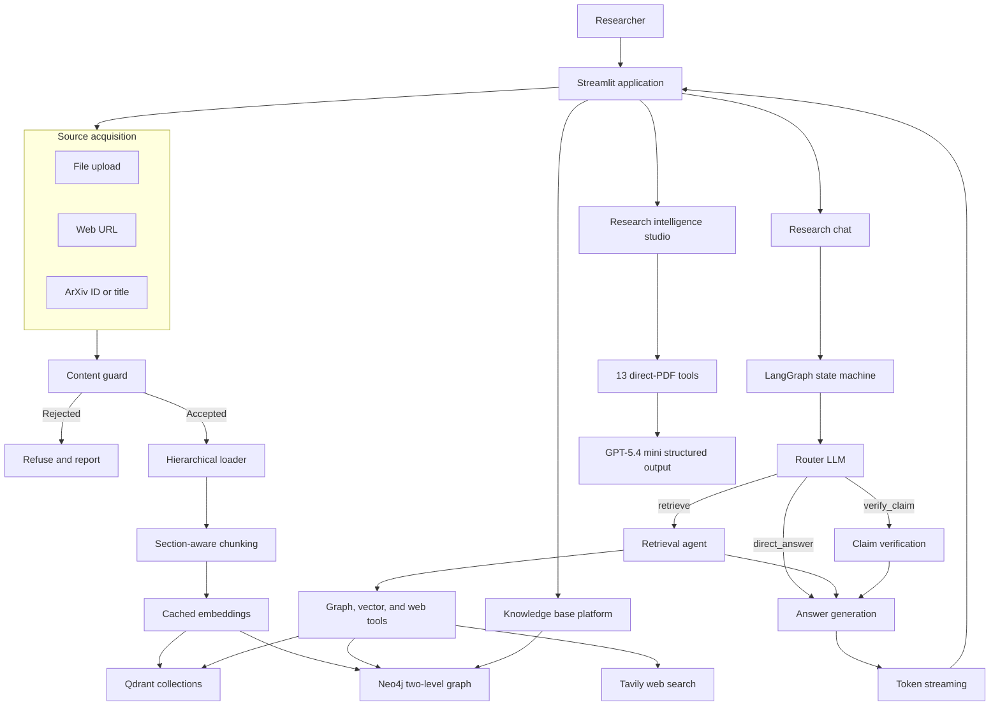

---

## Technology stack

Each technology was selected for a specific responsibility. The table states what the component is and why it suits this system.

| Layer | Technology | What it is | Why it suits this project |
|---|---|---|---|
| Interface | Streamlit | Python framework for data applications | Fast interactive UI with native session state, file upload, and component embedding for the graph canvas |
| Orchestration | LangGraph | State machine library for language model workflows | Supports cycles, conditional edges, injected state, and durable checkpoints, which the retrieval loop requires |
| Model toolkit | LangChain and LangChain Classic | Model, document, tool, and embedding abstractions | Provides text splitters, document loaders, tool nodes, cached embeddings, and vector-store integrations |
| Server model | OpenAI GPT-5.4 mini | Instruction-following language model | Used for routing, answering, knowledge extraction, verification, and structured research outputs |
| Lightweight model | OpenAI GPT-5 mini | Smaller model variant | Used for session naming and off-topic routing, where task complexity is low |
| Embeddings | OpenAI text-embedding-3-small | 1536-dimensional embedding model | Fixed 1536 dimensions match the Neo4j vector index and Qdrant collection configuration; lower cost than larger models for repeated chunk embedding |
| Vector store | Qdrant Cloud | Managed vector database with payload filtering | Provides cosine similarity search at scale with per-session collections and metadata payloads |
| Graph store | Neo4j 5.26 Community | Property graph database with vector and full-text indexes | Stores hierarchy, entities, provenance relationships, and embedded chunk vectors in one queryable graph |
| Web search | Tavily | Search API optimized for language model consumption | Returns concise result content and URLs suitable for context blocks and claim verification |
| Persistence | SQLite through LangGraph SqliteSaver | Embedded transactional store | Provides thread-scoped conversation checkpoints without a separate database service |
| Evaluation | DeepEval | RAG evaluation framework | Supplies context precision, recall, relevancy, answer relevancy, and faithfulness metrics with LLM judges |
| Packaging | uv and pyproject.toml | Python dependency and environment manager | Reproducible resolution recorded in uv.lock and compatible with the Docker build |
| Deployment | Docker and Docker Compose | Container runtime and multi-service definition | Runs Neo4j locally with deterministic ports and supports a containerized application profile |
| Visualization | HTML5 Canvas with custom JavaScript | Browser-native rendering | Delivers a self-contained interactive graph viewer without a frontend build pipeline |

---

## High-level architecture

The architecture separates four concerns: interaction, orchestration, storage, and external intelligence. The interaction layer never writes directly to a store; the orchestration layer owns all state transitions; storage layers remain substitutable; and external intelligence is called only through tools or guarded prompts.

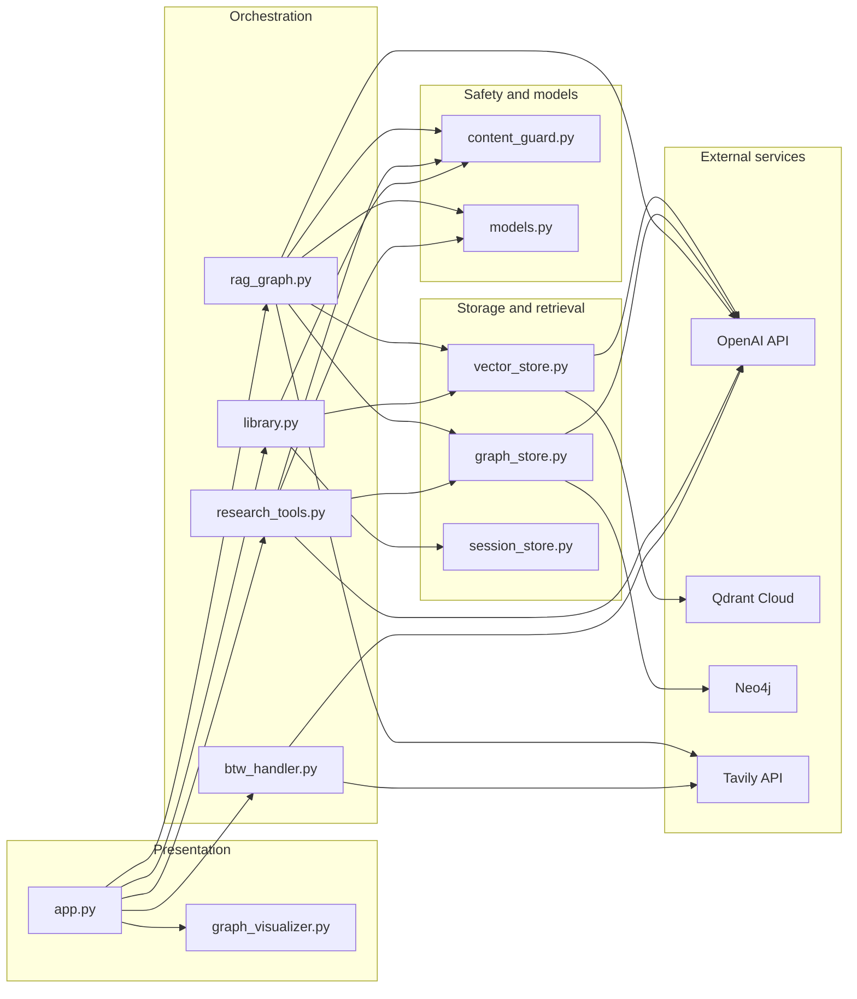

### Component responsibilities

| File | Responsibility |
|---|---|
| `app.py` | Builds the Streamlit interface, manages sessions, renders chat, research tools, and knowledge base explorer |
| `backend/rag_graph.py` | Defines the LangGraph state, nodes, tools, routing functions, and compiled graph |
| `backend/graph_store.py` | Implements Neo4j schema, ingestion, two-level retrieval, and explorer queries |
| `backend/vector_store.py` | Implements Qdrant collections, cached embedding access, corpus loading, and deduplication |
| `backend/paper_loader.py` | Loads PDF, text, Markdown, web, and arXiv sources into hierarchical chunks |
| `backend/content_guard.py` | Screens messages, uploads, URLs, and arXiv queries; scrubs and fences untrusted text |
| `backend/research_tools.py` | Defines 13 tool personas and executes structured analysis on direct PDFs and indexed corpora |
| `backend/models.py` | Declares Pydantic schemas for routing, verification, extraction, and tool output |
| `backend/session_store.py` | Persists source records, chat history, and tool history per session |
| `backend/library.py` | Coordinates saving, guarding, and indexing sources, including the shared corpus |
| `backend/btw_handler.py` | Handles off-topic side-channel questions without touching session state |
| `backend/graph_visualizer.py` | Generates a standalone HTML5 Canvas force-directed graph viewer |
| `evaluate.py` | Generates synthetic goldens, runs the RAG graph, evaluates five metrics, and writes results |

---

## Ingestion pipeline

Ingestion transforms an untrusted external source into two synchronized representations. The pipeline is deliberately ordered: safety screening happens before bytes are stored, and structural extraction happens before embedding, so every stored vector carries meaningful section metadata.

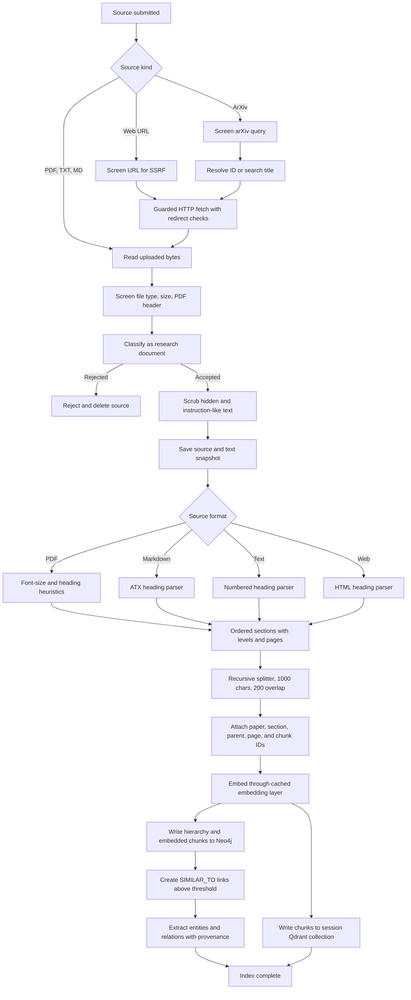

### Ingestion components

**Source acquisition.** The paper loader dispatch function inspects a source string. HTTP and HTTPS prefixes route to the web loader. File extensions route to the PDF, text, or Markdown loaders. The arXiv loader accepts either a bare identifier or a title phrase; it resolves a title through the arXiv Atom API, then downloads the corresponding PDF through the guarded read function. Every network fetch uses a custom redirect handler that re-screens each destination.

**Safety gate.** The content guard classifies uploaded bytes before they are saved. It enforces a 20 MB size ceiling, a 200 page ceiling for PDFs, allowed file suffixes, a PDF magic-header check, and plain-text validity. It then evaluates whether the document resembles a research paper by looking for a front-matter section, citation signals, and a minimum number of academic structure groups. A document containing critical instruction patterns is rejected unless it is long and strongly research-like; in that case it is accepted with neutralization, meaning instruction-like spans are scrubbed and the raw PDF binary is not attached to model calls.

**Structural extraction.** The PDF extractor reads font sizes from every text span, infers the body size from the most common font size, and treats larger lines or known section headings as boundaries. It assigns levels from numbering patterns or relative font size. If fewer than two sections are found, it falls back to page-level sections. Markdown parsing tracks fenced code blocks so headings inside code do not create false sections. Plain text and web pages use heading pattern recognition.

**Chunking.** Sections are split with a recursive character splitter using a chunk size of 1000 characters and an overlap of 200 characters. The overlap preserves sentences that cross a boundary. Each chunk receives a paper identifier, section identifier, parent section identifier, section path, section level, section order, page number where available, chunk index, and deterministic chunk identifier. Titles can be restamped after a temporary upload file receives its real filename; the restamp function rewrites all derived identifiers consistently.

**Embedding.** All chunks from one document are embedded in a batch through the shared cached embedding singleton. The same vectors are written to Qdrant and Neo4j, which guarantees identical similarity behaviour across both stores.

**Dual write.** `vector_store.add_paper` writes to Qdrant, then attempts the Neo4j graph write if Neo4j credentials are configured. Failures are captured independently. The operation succeeds when either store accepts the write, and reports the other store's error. This is the first layer of graceful degradation.

**Graph construction.** Neo4j ingestion creates the session and paper nodes, sections with parent and sequential links, chunks with embedded vectors and sequential links, similarity links computed by cosine comparison against existing session chunks, and Level 2 entities and relations. Extraction batches contain three chunks and run with five concurrent workers. Every entity and relation carries chunk indices and a verbatim evidence quote.

### Document journey: from upload to stored vectors

This walkthrough follows one uploaded PDF through every function call. The user-facing "injecter" is the sidebar ingestion path in `app.py`; the actual work is distributed across six backend modules. Each stage writes a concrete artifact, so a failure at any point can be traced to a specific file and function.

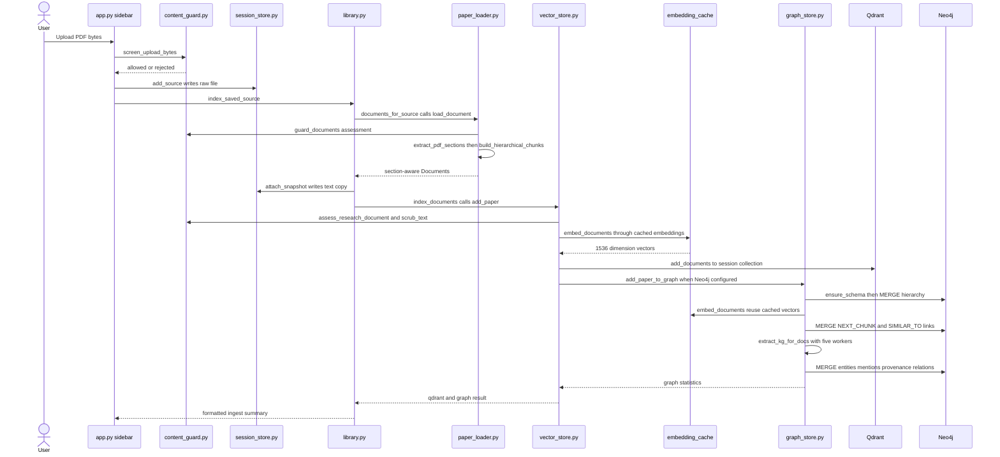

| Stage | Function | File | Artifact written |
|---|---|---|---|
| 1. Screen bytes | `screen_upload_bytes` | `backend/content_guard.py` | None; rejection stops the pipeline |
| 2. Save source | `add_source` | `backend/session_store.py` | Raw bytes under `session_data` and a source descriptor |
| 3. Load and guard | `documents_for_source` and `guard_documents` | `backend/library.py` | In-memory `Document` list with section metadata |
| 4. Parse structure | `_extract_pdf_sections` | `backend/paper_loader.py` | Sections with title, level, page, and text |
| 5. Chunk | `_build_hierarchical_chunks` | `backend/paper_loader.py` | Chunks with hierarchy and deterministic identifiers |
| 6. Snapshot text | `attach_snapshot` | `backend/session_store.py` | Plain-text copy for later tool use and fallback |
| 7. Re-guard and scrub | `add_paper` | `backend/vector_store.py` | Scrubbed page content |
| 8. Embed | `embeddings.embed_documents` | `backend/vector_store.py` | Cached 1536-dimensional vectors |
| 9. Vector write | `get_vectorstore().add_documents` | `backend/vector_store.py` | Points in the session Qdrant collection |
| 10. Graph schema | `ensure_schema` | `backend/graph_store.py` | Constraints and indexes in Neo4j |
| 11. Graph write | `add_paper_to_graph` | `backend/graph_store.py` | Paper, section, and chunk nodes with vectors |
| 12. Linking | `_link_similar_chunks` | `backend/graph_store.py` | `SIMILAR_TO` edges with similarity scores |
| 13. Semantic extraction | `_extract_kg_for_docs` | `backend/graph_store.py` | Entities, relations, mentions, and provenance edges |
| 14. Shared corpus | `index_documents` with `also_global` | `backend/library.py` | The same paper in the global Qdrant collection |

Parsing happens in `paper_loader.py` before any embedding. A PDF is parsed with font-size and heading heuristics, Markdown with ATX heading parsing, plain text with numbered heading patterns, and web pages with HTML heading parsing. Chunking happens immediately after parsing, also in `paper_loader.py`, so the splitter sees section boundaries rather than a flat string. Embedding happens only in stage 8, inside `vector_store.add_paper` and again through the same cache in `graph_store.add_paper_to_graph`. Storage is split: Qdrant receives vectors and payloads in stage 9, while Neo4j receives hierarchy and provenance in stages 11 through 13.

> **Note**: Stage 14 writes a second copy to the shared global corpus. This is why a paper uploaded in one session can answer questions in another session, while source files and chat history remain isolated.

---

## Retrieval pipeline

Retrieval is agentic rather than fixed. The language model chooses which tools to call, how many chunks to request, whether to expand hierarchy, and how many graph hops to traverse. The graph enforces a hard cap on tool-calling rounds.

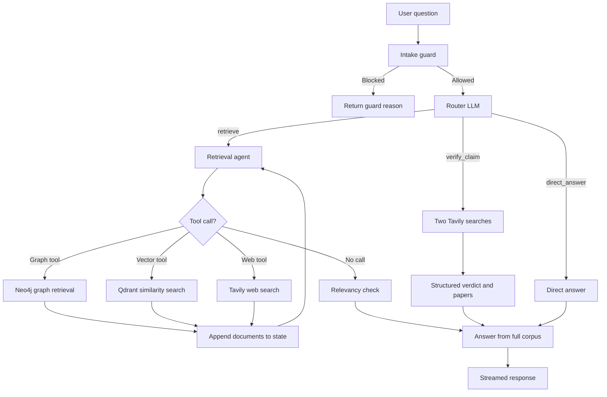

### Retrieval agent loop

The agent receives three tools. The graph retriever is the primary tool for paper questions. The vector retriever is a pure similarity complement and fallback. The web retriever handles current events and external information. Each tool returns a tool message for the model and a command that appends retrieved documents to graph state.

The agent loop terminates through three paths. A tool call executes and returns to the agent. No tool call with fewer than three attempts leads to a relevancy check. Reaching three attempts forces a plain language model call with no tools, which prevents orphaned tool call identifiers from entering the checkpoint history.

The relevancy check is intentionally advisory. The answer node always receives the complete indexed corpus, so a weak vector match cannot block an answer. This is a deliberate design decision recorded in the routing function and documented again in the constraints section.

### Retrieval signals

| Signal | Implementation | Failure mode it addresses |
|---|---|---|
| Vector seeds | Neo4j vector index query, with session-scoped cosine fallback | Paraphrased questions that share no exact terms |
| Entity seeds | Token match against canonical entity names and descriptions | Questions using precise technical terminology |
| Sequential neighbours | NEXT_CHUNK links in both directions | Findings that depend on adjacent methodology text |
| Section siblings | Parent and sibling chunks through HAS_CHUNK and SUBSECTION | Context spread across subsections |
| Shared entity hops | Chunks mentioning the same entity as a seed | Cross-section and cross-paper thematic links |
| Similarity links | SIMILAR_TO edges above the similarity threshold | Recurring concepts far apart in reading order |
| Semantic triples | RELATED_TO relations with provenance | Questions about relationships between methods and findings |
| Web results | Tavily documents appended to state | Questions requiring information outside the corpus |

### Fallback cascade

The graph tool implements a three-stage fallback. Neo4j retrieval runs first when configured. If it returns no documents or raises an exception, Qdrant similarity search runs. If both return nothing, the complete text of every indexed paper is attached with a full-paper-text reason marker. This cascade guarantees that a configured but temporarily empty graph never produces a silent failure.

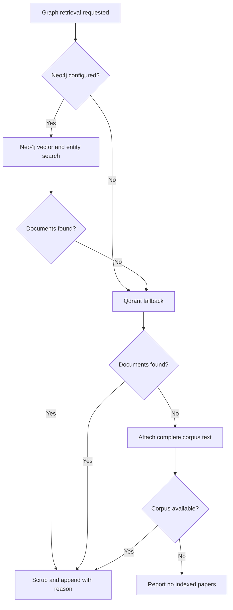

### Answer formation

The answer node has three branches. Paper questions and retrieve-routed questions call the paper answering path, which loads the full corpus, formats it by paper in reading order under a context cap, prepends the most relevant retrieved passages as hints, and instructs the model to synthesize across the whole document. Verification questions format the structured verdict and superseding papers without another generation call. Direct answers use a short system instruction with the untrusted-text rule.

### Question journey: from chat input to streamed answer

This walkthrough follows one paper question through the internal call chain. Unlike the ingestion path, the question path is cyclic: the agent may call tools repeatedly until the attempt cap is reached or it chooses to answer.

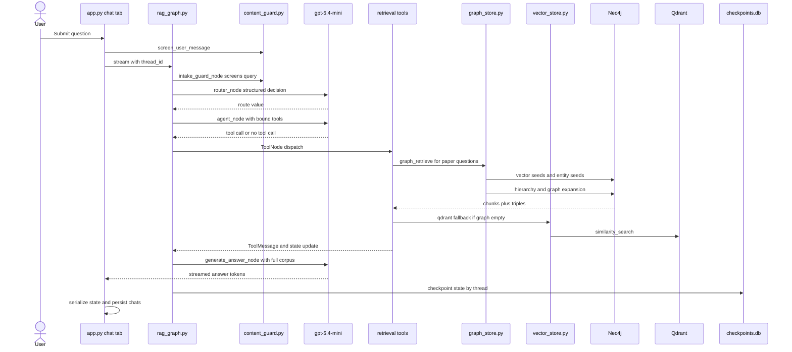

| Stage | Function or node | File | What changes |
|---|---|---|---|
| 1. Screen message | `screen_user_message` | `backend/content_guard.py` | Allowed question or immediate refusal |
| 2. Build input state | Chat tab handler | `app.py` | Messages, session identifier, query, empty retrieval fields |
| 3. Stream graph | `graph.stream` | `app.py` | Graph executes under the session thread identifier |
| 4. Guard node | `intake_guard_node` | `backend/rag_graph.py` | Sets `query` or sets `route` to blocked with a refusal answer |
| 5. Route | `router_node` | `backend/rag_graph.py` | Sets `route` to retrieve, verify_claim, or direct_answer |
| 6. Agent decision | `agent_node` | `backend/rag_graph.py` | Adds an AI message with tool calls and increments attempts |
| 7. Tool execution | `ToolNode` | `backend/rag_graph.py` | Appends retrieved documents to `retrieved_docs` |
| 8. Relevancy | `relevancy_check_node` | `backend/rag_graph.py` | Sets `is_relevant`; advisory only |
| 9. Answer | `generate_answer_node` | `backend/rag_graph.py` | Sets `answer` and appends the final AI message |
| 10. Stream to UI | Message-mode streaming | `app.py` | Tokens appear token by token in the chat area |
| 11. Inspect | `_serialize_state` | `app.py` | Expandable JSON view of the final state |
| 12. Persist | `save_chats` | `backend/session_store.py` | Chat list written to the session record |

Two side paths exist. A question beginning with `/btw` is routed to `handle_btw` and never enters the graph or the session record. A question assigned the verify_claim route bypasses the agent and runs two Tavily searches before formatting a verdict. Both paths are described in the retrieval and security sections.

---

## LangGraph implementation

### State design

Graph state is a typed dictionary extending the messages state. It carries both conversational history and retrieval control fields. The checkpointer serializes this state per thread, which means every field must remain serializable.

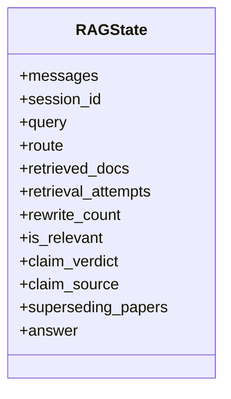

| Field | Purpose | Written by |
|---|---|---|
| `messages` | Conversation history including tool calls and results | Intake, agent, writeback, answer nodes |
| `session_id` | Scope for retrieval and checkpointer thread | UI input state |
| `query` | Guard-approved question text | Intake guard |
| `route` | Selected strategy or blocked marker | Intake guard, router |
| `retrieved_docs` | Accumulated context documents with reason metadata | Retrieval tools |
| `retrieval_attempts` | Count of tool-calling rounds | Agent node |
| `rewrite_count` | Count of query rewrites | Query rewrite node |
| `is_relevant` | Relevancy gate result | Relevancy node |
| `claim_verdict` | Verification summary | Verification node |
| `claim_source` | URL of the first superseding paper | Verification node |
| `superseding_papers` | Structured list of newer papers | Verification node |
| `answer` | Final response text | Answer node |

### Graph topology

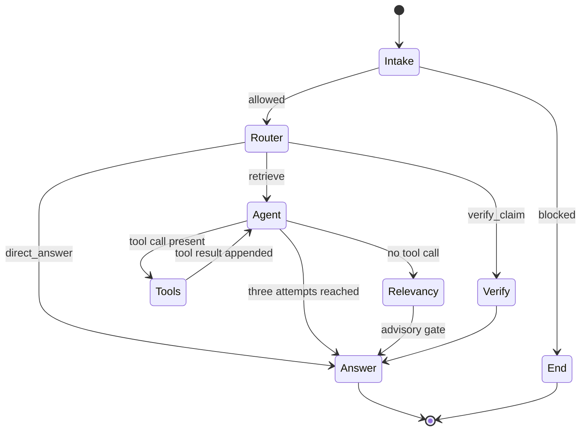

The compiled graph uses conditional edges after intake, routing, the agent, and relevancy. The ingestion of pending tool calls always takes precedence over shortcuts, because skipping a tool result would leave an unmatched tool call in the persisted message history. This detail is documented in the source and matters for long sessions.

### Node inventory

| Node | Function | Notes |
|---|---|---|
| `intake_guard` | `intake_guard_node` | Screens the question before any model call |
| `router` | `router_node` | Structured output constrained to three route values |
| `agent_node` | `agent_node` | Binds tools below the attempt cap; plain model at the cap |
| `retrieval` | `ToolNode` | Executes the three declared retrieval tools |
| `relevancy_check` | `relevancy_check_node` | LLM decision on chunk relevance, advisory only |
| `query_rewrite` | `query_rewrite_node` | Rewrites a failed query with a guard on the rewrite |
| `verify_claim` | `verify_claim_node` | Two Tavily searches plus structured verdict |
| `generate_answer` | `generate_answer_node` | Produces the final response for all routes |

### Router LLM

The router uses a system prompt that defines three categories. Retrieve covers any question about uploaded papers and any question requiring live information. Verify claim covers requests to check whether a finding still holds. Direct answer covers stable general knowledge. The prompt explicitly prefers retrieve when the classifier is uncertain, which biases the system toward grounded answers. The output is constrained by the `RouterDecision` Pydantic model, so invalid route values cannot enter the graph.

### Turn sequence

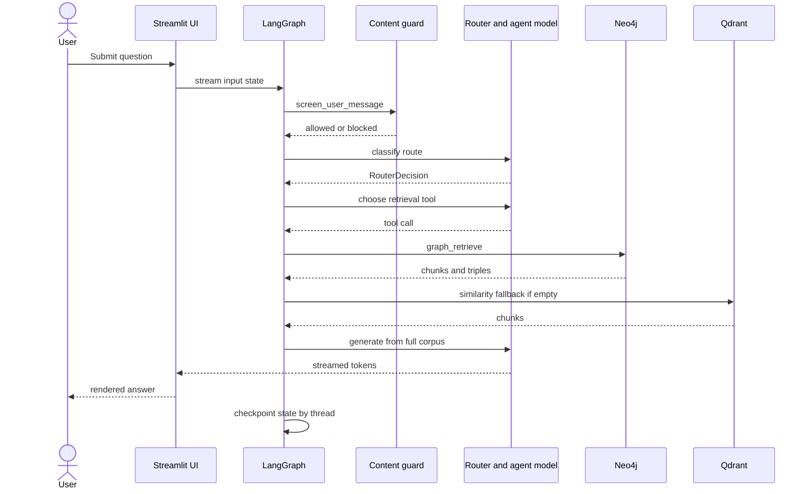

### State transition walkthrough

Consider the question "What limitations does the paper report?" arriving in a fresh session. The following table shows how the graph state changes at each step. Fields not listed retain their previous value. This concrete trace makes the abstract state diagram operational.

| Stage | `route` | `retrieved_docs` | `retrieval_attempts` | `is_relevant` | `answer` |
|---|---|---|---|---|---|
| UI input state | `None` | empty | 0 | `None` | `None` |
| After `intake_guard` | `None` | empty | 0 | `None` | `None`; `query` is set |
| After `router` | `retrieve` | empty | 0 | `None` | `None` |
| After first `agent_node` | `retrieve` | empty | 1 | `None` | `None`; tool call in messages |
| After `retrieval` | `retrieve` | populated | 1 | `None` | `None`; tool result appended |
| After second `agent_node` | `retrieve` | populated | 1 | `None` | `None`; no tool call |
| After `relevancy_check` | `retrieve` | populated | 1 | `True` | `None` |
| After `generate_answer` | `retrieve` | populated | 1 | `True` | Final grounded text |

Two other traces show why the guard and the router matter. An injection attempt sets `route` to `blocked` in the intake node, so the router never runs and the refusal text becomes the answer. A verification request sets `route` to `verify_claim`, so the agent loop is skipped entirely; `claim_verdict` and `superseding_papers` are filled by the verification node and the answer node formats them without another model call.

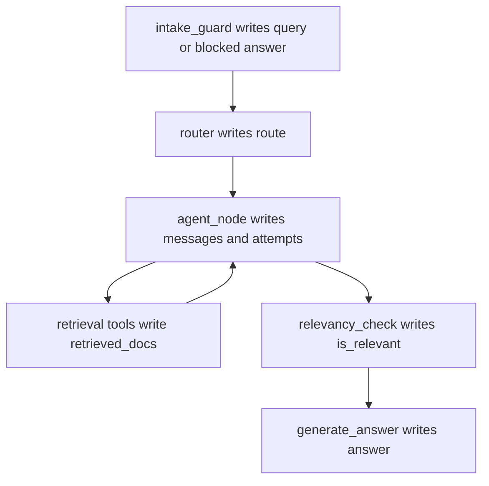

### Why each node exists

The graph topology is not arbitrary. Every node handles one failure mode that a simpler linear chain would leave unmanaged.

| Node | Reads | Writes | Why it exists |
|---|---|---|---|
| `intake_guard` | `query` or last message | `query`, blocked `answer` | Stops injection before any provider call, including the router |
| `router` | Last message content | `route` | Selects the correct strategy so paper questions are never answered from memory alone |
| `agent_node` | Messages, `retrieval_attempts` | Tool calls or answer-bound message, `retrieval_attempts` | Gives the model control over retrieval depth while enforcing a hard cap |
| `retrieval` | Tool arguments, injected state | Tool messages, `retrieved_docs` | Executes graph, vector, and web tools without letting them write directly to state |
| `relevancy_check` | `query`, first five documents | `is_relevant` | Records a relevance decision for observability without blocking the answer |
| `query_rewrite` | Original query, `rewrite_count` | New human message, reset attempts, incremented count | Provides an alternative search phrasing when retrieval is weak |
| `verify_claim` | Last message content | `claim_verdict`, `claim_source`, `superseding_papers` | Handles temporal validity through two independent search sources |
| `generate_answer` | `route`, query, corpus, retrieved documents | `answer`, final AI message | Produces the single user-facing response for all three routes |

The two conditional edges that matter most are after the agent and after routing. The agent edge always executes pending tool calls before any shortcut, because skipping a tool result leaves an unmatched tool call identifier in the checkpoint and corrupts every later turn in that session. The routing edge prevents verification requests from spending retrieval attempts on paper tools.

---

## Security architecture

### Guard chain

Every untrusted input crosses a local guard before any model call, file write, vector write, or graph write. The guard chain is deterministic and uses no external service.

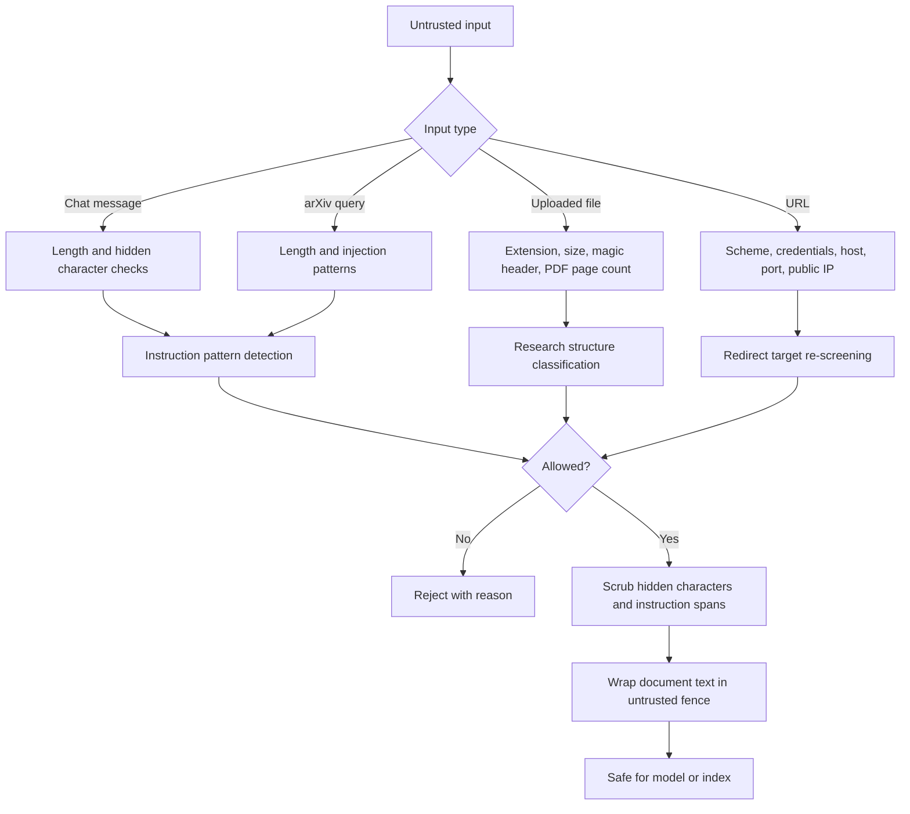

### Defense inventory

| Defense | Implementation | Threat addressed |
|---|---|---|
| Empty and length checks | `screen_user_message`, `screen_arxiv_query` | Resource exhaustion and oversized prompts |
| Instruction pattern detection | Compiled critical and suspicious regular expressions including role changes, prompt requests, and token markers | Direct prompt injection |
| Hidden payload detection | Zero-width and bidirectional character scanning plus base64 decode inspection | Obfuscated injection |
| Research document classification | Front matter, citation signals, structure groups, and non-research markers | Uploaded resumes, invoices, and unrelated documents |
| Neutralization | Scrubbing instruction-like spans and suppressing raw PDF attachment | Indirect injection through paper text |
| URL screening | Allowed schemes, no embedded credentials, blocked local hosts, allowed ports, DNS resolution to public addresses | Server-side request forgery |
| Redirect screening | Custom redirect handler revalidates every destination | Redirect-based SSRF bypass |
| Download and page caps | 20 MB and 200 page limits | Resource exhaustion |
| Untrusted fencing | `<untrusted_research_text>` wrappers plus explicit model rules | Confusing document text with system instruction |
| Read-only Cypher | Write keyword blocklist in the explorer console | Accidental or malicious graph mutation through the UI |
| Verification source restriction | Structured prompt requires titles and URLs that appear verbatim in search results | Fabricated citations in verification output |

### Threat model boundaries

The system defends against injection, non-research uploads, private network fetches, oversized inputs, and accidental graph writes through the explorer. It does not provide user authentication, multi-tenant access control at the HTTP layer, or rate limiting. The Qdrant and OpenAI credentials are process-wide, so the application assumes a trusted single-operator deployment. The session boundary protects data organization and model context, not adversarial access to the host.

> **Important**: The content guard is a local heuristic layer. It reduces risk but does not replace provider-level safeguards, network policy, or human review of sensitive research material.

---

## Hybrid search implementation

Hybrid search in this project means combining multiple retrieval signals inside one graph tool, then applying a relevancy gate before generation. The implementation lives in `graph_store.graph_retrieve` and the agent tool in `rag_graph.retrieve_from_knowledge_graph`.

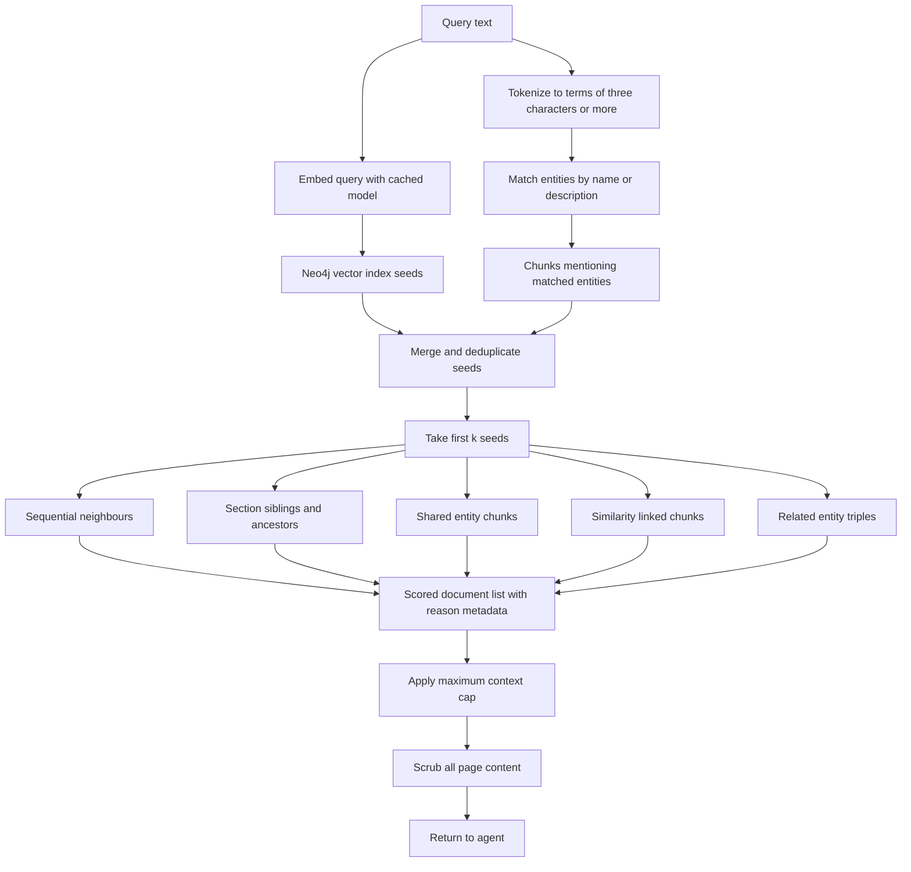

### Ranking and relevancy

Ranking comes from three explicit signals. Vector seeds carry a cosine score from the Neo4j vector index or the session-scoped fallback calculation. Entity seeds order by the number of distinct matched entities. Expansion rows order by similarity score or by section distance where applicable. The relevancy check then asks a language model whether the snippets meaningfully address the question and returns a boolean decision with a reason.

> **Note**: The project does not use a cross-encoder reranking model. Ranking is produced by similarity scores and match counts, followed by an LLM relevancy gate. Describing the system as using neural reranking would be inaccurate.

### Chunk extraction internals

The public entry point is `graph_retrieve`. It does not issue a single query; it orchestrates a sequence of Cypher reads and then constructs LangChain `Document` objects from the returned rows. The following diagram names the internal functions so the retrieval path can be traced in source.

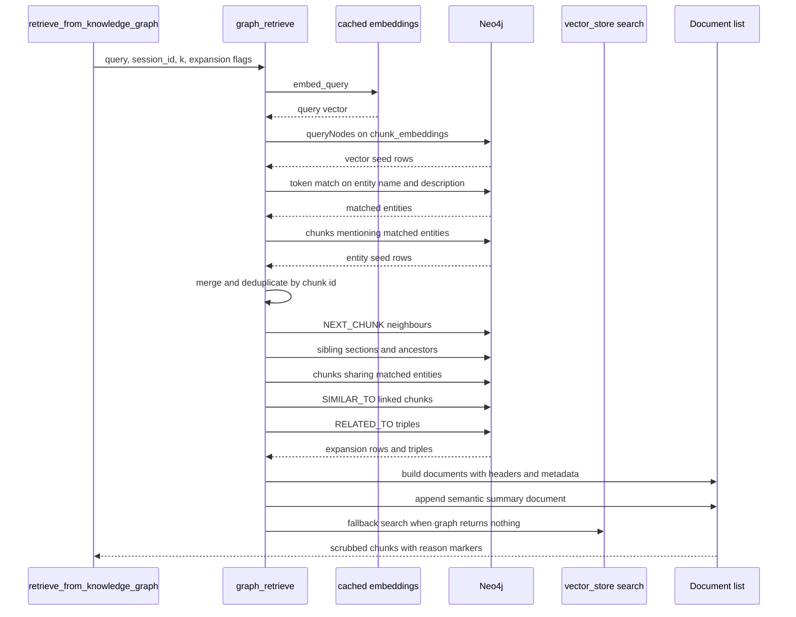

| Step | Function | Mechanism | Output |
|---|---|---|---|
| 1 | `embeddings.embed_query` | Cached text embedding model | Query vector of dimension 1536 |
| 2 | `_vector_seed_chunks` | Neo4j vector index with session filter | Top k chunk rows with cosine scores |
| 3 | `_vector_seed_chunks` fallback | In-memory cosine comparison over session chunks | Session-scoped seeds if the global index is dominated elsewhere |
| 4 | `_entity_seed_chunks` | Token match against canonical names and descriptions | Up to eight matched entities |
| 5 | `_entity_seed_chunks` | MENTIONS traversal ordered by match count | Entity-backed chunk rows |
| 6 | `graph_retrieve` merge | Deduplicate by chunk identifier, preserve order | Seed list limited to k |
| 7 | `_expand_hierarchy_and_graph` | NEXT_CHUNK, section siblings, ancestor titles | Sequential and structural context |
| 8 | `_expand_hierarchy_and_graph` | Shared entity and SIMILAR_TO traversals | Cross-section and cross-paper context |
| 9 | `_expand_hierarchy_and_graph` | RELATED_TO relations | Triple rows with provenance and quotes |
| 10 | `graph_retrieve` construction | Build headers with paper, section, page, and reason | LangChain documents with retrieval metadata |
| 11 | `graph_retrieve` summary | Format entities and triples as one document | Semantic graph summary document |
| 12 | Tool wrapper | Apply `scrub_text` and enforce the context cap | Final appended context |

The expansion cap is `max(k * 3, 10)` documents. Every document carries a `retrieval_reason` such as vector seed, entity seed, sequential neighbour, section sibling, shared entity hop, semantic link, or semantic triples. Those reasons are aggregated in the chat interface and displayed as a two-level retrieval breakdown, which makes the hybrid behaviour observable to the operator.

### Why hybrid is necessary here

Vector search alone cannot resolve a question that depends on a paper's experimental setup when the answer sentence itself contains no distinguishing terms. Entity matching alone fails on paraphrase. Hierarchy expansion alone floods context with adjacent chunks that may be irrelevant. Combining them lets the agent trade precision for context deliberately through the `expand_hierarchy` and `expand_graph_hops` parameters.

---

## GraphRAG data model and schema

### Neo4j schema

The graph uses five node labels. Session scopes every entity so paper corpora from different sessions never mix during retrieval. Deterministic identifiers make ingestion idempotent through `MERGE`.

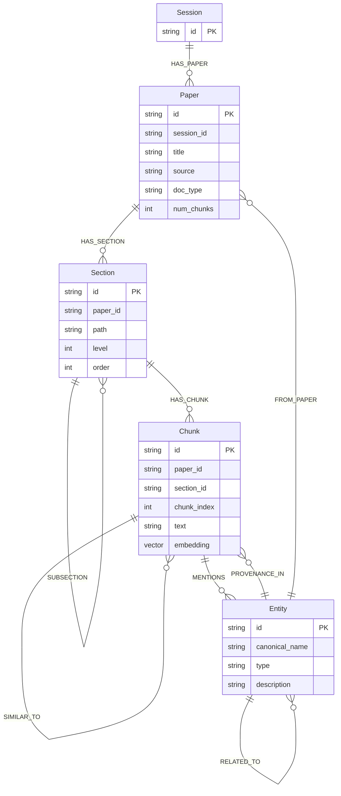

### Node and property design

| Label | Key properties | Purpose |
|---|---|---|
| `Session` | `id` | Root scope for all session data |
| `Paper` | `id`, `session_id`, `title`, `source`, `doc_type`, `num_chunks`, `updated_at` | Document identity and metadata |
| `Section` | `id`, `paper_id`, `title`, `path`, `level`, `order`, `page`, `parent_section_id` | Document hierarchy |
| `Chunk` | `id`, `paper_id`, `section_id`, `text`, `embedding`, `chunk_index`, `start_index`, `page` | Retrieval unit and vector carrier |
| `Entity` | `id`, `canonical_name`, `name`, `type`, `description`, `knowledge_level` | Level 2 semantic node |

Semantic types are constrained to Concept, Method, Dataset, Metric, and Finding. A dynamic label matching the type is also applied to each entity node, which allows Cypher queries by label.

### Edge design

| Edge | Endpoints | Key properties |
|---|---|---|
| `HAS_PAPER` | Session to Paper | None |
| `HAS_SECTION` | Paper to Section | None |
| `SUBSECTION` | Section to Section | None |
| `HAS_CHUNK` | Section to Chunk | None |
| `NEXT_CHUNK` | Chunk to Chunk | None |
| `SIMILAR_TO` | Chunk to Chunk | `score` |
| `MENTIONS` | Chunk to Entity | `paper_title`, `section_path`, `page`, `chunk_index`, `evidence_quote` |
| `PROVENANCE_IN` | Entity to Chunk | Same provenance properties as MENTIONS |
| `FROM_PAPER` | Entity to Paper | `paper_title` |
| `RELATED_TO` | Entity to Entity | `relation`, `description`, `evidence_quote`, paper and section provenance |

### Indexes and constraints

The schema function creates uniqueness constraints on session, paper, section, chunk, and entity identifiers. It creates indexes on session identifiers for each stored label. It creates a 1536-dimension cosine vector index named `chunk_embeddings` and full-text indexes over chunk text and section titles, and over entity names and descriptions. Schema creation is guarded by a module-level flag so repeated ingestion does not reissue statements.

### Chunking strategy

Chunking is section-aware rather than character-blind. A section with known level and page becomes a metadata envelope. The recursive splitter divides only that section's text, with 1000 characters per chunk and 200 characters of overlap. Deterministic chunk identifiers combine a paper identifier derived from title and source with a running chunk index. This approach gives each chunk three anchors: where it sits in the document, what it says, and which semantic entities claim it.

### Embedding technology and rationale

The system uses `text-embedding-3-small` through `OpenAIEmbeddings`. The embedding dimension is fixed at 1536 in code to match the model and is reused for both the Qdrant collection configuration and the Neo4j vector index configuration. Cosine distance is used in both stores. A single cached embedding object is imported by both storage modules, which guarantees that the same text produces the same vector representation regardless of destination.

The choice is driven by three concrete requirements visible in the code. The dimension must be fixed so a single Neo4j vector index can serve all chunks. The model must support batch embedding for concurrent graph extraction workloads. The cost per embedded token must remain low because every chunk is embedded at least once and query embeddings occur on every retrieval. Larger models would increase cost and change the index dimension without changing the retrieval architecture.

### Metadata storage

Metadata appears in three places with different purposes. Qdrant payloads hold title, chunk index, section path, page, paper identifier, chunk identifier, and document type for filtering and reconstruction. Neo4j node properties hold the same identity fields plus hierarchy position and the vector. LangGraph checkpoints hold conversation state, retrieved documents, and answer text in SQLite. Session records in JSON hold saved source descriptors and snapshot paths, while `sessions.json` holds display names and creation metadata.

| Store | Format | Scope | Contents |
|---|---|---|---|
| Qdrant | Vector collection per session | Session and global corpus | Vector, page content, metadata payload |
| Neo4j | Property graph | Session scoped | Hierarchy, entities, provenance, vectors |
| SQLite | LangGraph checkpoints | Thread identifier | Messages, retrieval state, answer |
| JSON session records | Files under `session_data` | Session | Sources, chats, tool history |
| `sessions.json` | JSON object keyed by session identifier | Application | Display name, timestamps, naming flag, kind |
| `embedding_cache` | Local file store | Global | Cached query and document embeddings |

---

## Production engineering

### Overview

The production design addresses cost, latency, isolation, persistence, and reproducibility. Each mechanism has a specific implementation location.

| Mechanism | Implementation | Benefit |
|---|---|---|
| Embedding cache | `CacheBackedEmbeddings` over `LocalFileStore` | Identical text is never re-embedded across sessions or restarts |
| Session isolation | Session-scoped collections and graph identifiers | Prevents paper leakage between conversations |
| Graph caching | `st.cache_resource` with a code token | Graph is built once and rebuilt when source files change |
| Streaming | `graph.stream` in message mode | Tokens appear as the model generates them |
| Session persistence | JSON records plus SQLite checkpointer | Conversations survive restarts |
| Temp file cleanup | `finally` blocks in arXiv and upload paths | Uploaded and downloaded files are removed after processing |
| Async evaluation | DeepEval async config with throttle | Evaluation stays within provider rate limits |
| ArXiv reliability | Targeted Tavily searches for verification | Avoids unreliable library behaviour during claim checks |
| Graceful degradation | Independent Qdrant and Neo4j error capture | App remains usable when one backend fails |

### Embedding caching

The embedding layer wraps the base OpenAI model in a cache backed by a local file store with a BLAKE2B key encoder. Query embedding caching is enabled. Because the cache namespace is the model name, changing models would naturally produce a new key space. The practical effect is that repeated ingestion of the same paper, re-indexing from multiple sessions, and repeated queries for the same text avoid provider calls.

### Session isolation and the shared corpus

Each session receives a Qdrant collection named with the session identifier and a Neo4j graph scope keyed by the same identifier. A special global session identifier holds a shared corpus. When a paper is added to a session, the library module also writes it to the global corpus. The retrieval search function searches both the global corpus and the current session, deduplicates by content marker, and caps results. This design gives researchers cross-session awareness without merging session histories.

### Graph caching and the code token

Streamlit reruns the script on every interaction. Building the LangGraph graph on every rerun would create repeated SQLite connections. The graph is cached with a token derived from the modification times of `rag_graph.py` and `vector_store.py`. Editing either file changes the token, so Streamlit rebuilds the graph automatically.

### Streaming and state inspection

The chat interface streams tokens only from the answer node. Other nodes may call tools or models, but their intermediate output is not shown as answer text. After streaming, the final graph state is serialized into a compact JSON view with truncated messages and document previews. This gives operators a debugging view without exposing full document bodies in the interface.

### Persistence

Three persistence layers cooperate. `sessions.json` stores session metadata and names. `session_data/<id>/record.json` stores sources, chats, and tool history. `checkpoints.db` stores LangGraph thread state. The first message in a session triggers an LLM-generated title. The evaluation session is intentionally excluded from chat and tool persistence.

### Evaluation concurrency

The evaluation pipeline invokes the RAG graph for each golden question with a unique session, then evaluates all test cases through DeepEval with three concurrent workers and a five second throttle. This keeps provider calls within practical rate limits while avoiding a fully sequential run.

### Constraints and rationale

| Constraint | Value | Rationale |
|---|---|---|
| Maximum query rewrites | 3 | Prevents infinite loops and token burn on ambiguous questions |
| Chunk size and overlap | 1000 and 200 characters | Balances retrieval precision with sentence continuity |
| Default retrieval chunks | 4 | Balances context richness with prompt length |
| Web results for side channel | 3 | Keeps lightweight off-topic answers concise |
| Similarity link threshold | 0.78 cosine | Limits semantic links to genuinely related chunks |
| Similarity links per chunk | 2 | Prevents a dense link web from dominating context |
| KG extraction batch size | 3 chunks | Keeps extraction prompts focused and structured |
| KG extraction workers | 5 | Parallelizes extraction without overwhelming the provider |
| Retrieval attempts | 3 | Caps agent tool-calling rounds and protects checkpoint integrity |
| Upload size | 20 MB | Prevents oversized storage and embedding cost |
| PDF page limit | 200 | Keeps extraction time and token usage bounded |
| Research text minimum | 800 characters | Avoids classifying fragments as papers |
| Evaluation threshold | 0.7 | Standard pass mark used by the five DeepEval metrics |
| Cypher explorer | Read-only | Prevents graph mutation from the UI console |

---

## Evaluation

### Metric suite

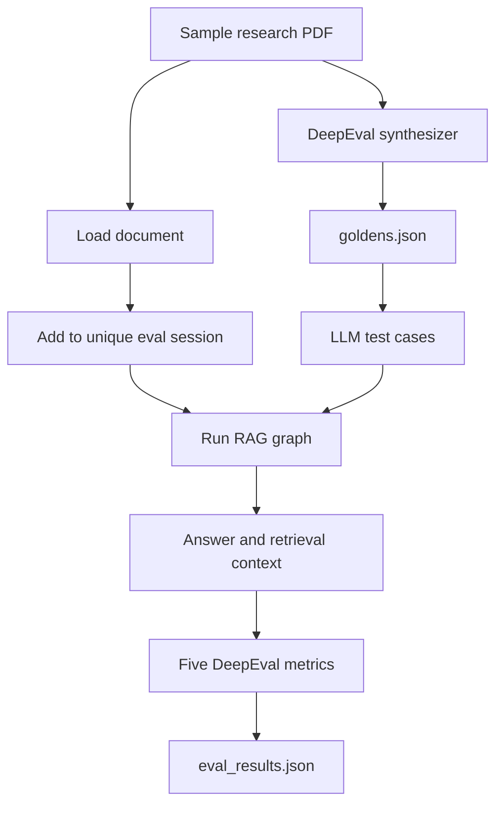

| Metric | Question answered | Threshold |
|---|---|---|
| Contextual Precision | Are relevant chunks ranked ahead of irrelevant chunks | 0.7 |
| Contextual Recall | Does retrieved context cover the expected answer | 0.7 |
| Contextual Relevancy | Is the retrieved context relevant to input and expected output | 0.7 |
| Answer Relevancy | Does the answer address the question | 0.7 |
| Faithfulness | Is the answer grounded in retrieved context | 0.7 |

### Result file structure

`goldens.json` is a list of objects with `input` and `expected_output` keys. It is generated once from the sample PDF and reused on later runs. `eval_results.json` is a list of case objects. Each case contains the question text in `input`, the generated text in `actual_output`, an overall `success` boolean, and a `metrics` list. Each metric object contains `name`, `score`, `passed`, and a natural language `reason`. The evaluation tab in the application reads this file and computes averages and pass counts.

### Last recorded run

The checked-in evaluation output contains ten cases, of which five passed. The following averages are computed directly from that file and are reported as a historical snapshot, not as a guaranteed performance level.

| Metric | Average | Minimum | Maximum |
|---|---|---|---|
| Contextual Precision | 0.978 | 0.833 | 1.000 |
| Contextual Recall | 1.000 | 1.000 | 1.000 |
| Contextual Relevancy | 0.576 | 0.094 | 0.974 |
| Answer Relevancy | 0.991 | 0.909 | 1.000 |
| Faithfulness | 0.981 | 0.938 | 1.000 |

The weak metric is contextual relevancy. Its low scores occur when retrieved context contains passages that are topically related to the document but not to the specific question. This observation motivates the relevancy gate and the full-corpus answer strategy: the system tolerates imprecise retrieval because the answer stage can ignore irrelevant context, but the metric still penalizes the context list. Improving chunk-level relevance remains the clearest evaluation improvement opportunity.

> **Note**: The evaluation results depend on the sample report, model versions, and provider behaviour at the time of the run. Regenerate them with the current environment before using them for comparison.

---

## Repository map

| Path | Contents |
|---|---|
| `README.md` | This architecture and operations guide |
| `app.py` | Streamlit interface, session bootstrap, sidebar ingestion, three tabs, and knowledge base explorer |
| `main.py` | Minimal package entry point retained from project scaffolding |
| `evaluate.py` | Golden generation, RAG invocation, DeepEval execution, and result serialization |
| `backend/__init__.py` | Empty package marker |
| `backend/models.py` | Pydantic schemas for routing, verification, extraction, and tool output |
| `backend/content_guard.py` | Screening, classification, scrubbing, fencing, and guarded HTTP fetch |
| `backend/paper_loader.py` | Source loaders, section parsers, hierarchical chunk builder, and arXiv handling |
| `backend/vector_store.py` | Embedding singletons, Qdrant collections, search, corpus loading, and merging |
| `backend/graph_store.py` | Neo4j configuration, schema, ingestion, retrieval, and explorer queries |
| `backend/rag_graph.py` | LangGraph state, tools, nodes, routing, and compiled graph |
| `backend/research_tools.py` | Thirteen tool specifications, PDF context extraction, execution, and Markdown formatting |
| `backend/session_store.py` | Session record read and write helpers |
| `backend/library.py` | Source document loading, guard application, indexing, and shared corpus maintenance |
| `backend/btw_handler.py` | Off-topic side-channel handler |
| `backend/graph_visualizer.py` | Self-contained interactive graph HTML generator |
| `tests/test_content_guard.py` | Local safety check tests with no model calls |
| `tests/test_graph_rag.py` | Hierarchy, graph ingestion, retrieval, visualization, and research tool tests |
| `docker-compose.yml` | Neo4j service and optional application service definition |
| `Dockerfile` | Python 3.12 application image with layered dependency and source copies |
| `pyproject.toml` | Project metadata and dependency declarations |
| `uv.lock` | Locked dependency resolution |
| `requirements.txt` | Flat dependency list used by the Dockerfile |
| `.env.example` | Template for all provider and Neo4j configuration |
| `.env` | Local secrets and endpoints, never committed |
| `.gitignore` | Ignore rules for secrets, caches, runtime data, databases, and generated artifacts |
| `start.ps1` and `start.bat` | Start Docker services and Streamlit with logging and error handling |
| `stop.ps1` and `stop.bat` | Stop Streamlit and Docker services with logging and verification |
| `sessions.json` | Session names and metadata |
| `goldens.json` | Cached synthetic evaluation questions |
| `eval_results.json` | Persisted DeepEval results |
| `session_data/` | Saved source files, snapshots, chat history, and tool history |
| `documents/` | Sample research report used by tests, evaluation, and the knowledge base demo |
| `embedding_cache/` | Local embedding cache files |
| `checkpoints.db` | LangGraph SQLite checkpoint store |
| `logs/` | Start, stop, and Streamlit output logs |
| `scratch_cleanup.py` | One-time script that removes test nodes from Neo4j |
| `graph.png` | Generated graph visualization artifact |

---

## Running the project

### Prerequisites

| Requirement | Verification |
|---|---|
| Python 3.12 or newer | `python --version` |
| uv | `uv --version` |
| Docker Desktop with Compose v2 | `docker compose version` |
| OpenAI API key | Available from the OpenAI platform |
| Tavily API key | Available from Tavily |
| Qdrant Cloud cluster and API key | Available from Qdrant Cloud |

### Configuration

Copy the template and fill in the provider values.

```bash
cp .env.example .env
```

| Variable | Purpose |
|---|---|
| `OPENAI_API_KEY` | Language model inference and embeddings |
| `TAVILY_API_KEY` | Web search and claim verification |
| `QDRANT_URL` | Qdrant Cloud cluster endpoint |
| `QDRANT_API_KEY` | Qdrant Cloud authentication |
| `NEO4J_HTTP_URL` | Neo4j HTTP endpoint, normally `http://localhost:7476` |
| `NEO4J_URI` | Neo4j Bolt endpoint, normally `bolt://localhost:7689` |
| `NEO4J_USERNAME` | Neo4j user, normally `neo4j` |
| `NEO4J_PASSWORD` | Password configured for the local container |
| `NEO4J_DATABASE` | Database name, normally `neo4j` |

In Qdrant Cloud, `QDRANT_URL` is the endpoint on the cluster overview page and `QDRANT_API_KEY` comes from the API Keys tab. The key is shown once, so copy it immediately.

### Local start and stop

```powershell
.\start.ps1
.\start.ps1 -OpenBrowser
.\start.ps1 -Port 8502
.\start.ps1 -SkipDocker
.\stop.ps1
.\stop.ps1 -RemoveContainers
.\stop.ps1 -SkipDocker
```

The start script raises the Neo4j service, waits for its endpoint, creates `.env` when missing, installs dependencies when the virtual environment is absent, starts Streamlit, writes the process identifier, and waits for the health endpoint. The stop script terminates only processes confirmed to belong to this project, releases the port, then stops Compose services. All steps are written to `logs\start.log` and `logs\stop.log`. Docker failures are logged as warnings and do not prevent the application from starting because Qdrant fallback is available.

### Manual commands

```bash
uv sync
uv run streamlit run app.py
docker compose up -d neo4j
docker compose stop
docker compose down
```

### Tests and evaluation

```bash
uv run python -m pytest tests -q
uv run python evaluate.py
```

The test suite covers content guard behaviour, Markdown and PDF hierarchy extraction, mocked two-level ingestion and retrieval, read-only Cypher enforcement, graph HTML generation, and all thirteen research tool specifications. Evaluation generates goldens on first run, caches them in `goldens.json`, writes fresh results to `eval_results.json`, and displays them in the Evaluation session of the application.

### Deployment

```bash
docker build -t ai-research-paper-assistant .
docker tag ai-research-paper-assistant <registry-user>/ai-research-paper-assistant:latest
docker push <registry-user>/ai-research-paper-assistant:latest

docker run -d -p 8501:8501 \
  -e OPENAI_API_KEY=<key> -e TAVILY_API_KEY=<key> \
  -e QDRANT_URL=<url> -e QDRANT_API_KEY=<key> \
  --name ai-research-paper-assistant \
  <registry-user>/ai-research-paper-assistant:latest
```

Open the server address on port 8501 and allow inbound traffic on that port. `docker ps`, `docker logs`, `docker stop`, and `docker rm` manage the container. On a fresh Ubuntu host, install Docker Engine and the Compose plugin from the official Docker apt repository, then add the operator account to the `docker` group.

### Troubleshooting

| Symptom | Likely cause | Resolution |
|---|---|---|
| Neo4j Browser login fails with unauthorized error | Browser connects to the default 7687 port instead of 7689 | Set the connect URL to `bolt://localhost:7689` |
| Application starts without graph features | Neo4j credentials missing or container stopped | Run `docker compose up -d neo4j` and confirm `NEO4J_PASSWORD` |
| Upload rejected as non-research | Document lacks academic structure or citation signals | Upload an actual paper with abstract and references |
| Upload rejected as injection | Text contains instruction override patterns | Remove the offending text or use a clean source |
| Port 8501 already in use | Another application owns the port | Use `start.ps1 -Port 8502` |
| Empty chat answers | Provider keys missing or invalid | Fill `.env` and restart |
| Stale graph behaviour after code edits | Cached graph not invalidated | Edit source files to change the cache token or restart Streamlit |
| Evaluation fails on rate limits | Too many concurrent provider calls | Increase the throttle value in `evaluate.py` |

---

## Glossary

| Term | Definition |
|---|---|
| Chunk | A section-bounded text segment with metadata and an embedding, used as the atomic retrieval unit |
| Document hierarchy graph | Level 1 graph connecting papers, sections, subsections, and chunks |
| Semantic graph | Level 2 graph connecting entities to chunks and to each other with provenance |
| Provenance | The paper, section, page, chunk, and verbatim quote attached to an extracted fact |
| Hybrid retrieval | Combining vector, entity, hierarchy, and similarity signals before generation |
| Graph expansion | Adding chunks adjacent to seed chunks through hierarchy or graph relationships |
| Guardrail | A local deterministic check that runs before untrusted input reaches a model or store |
| Checkpointer | LangGraph component that persists state per thread in SQLite |
| Global corpus | Shared session that aggregates papers from all sessions for cross-session answering |
| Side channel | The `/btw` path that answers off-topic questions without writing session history |
| Golden | Synthetic question and expected answer used for evaluation |
| Citation grounding | Keeping paper identity and evidence quotes attached to claims throughout retrieval and answering |

---

## Further reading

**Official documentation**

- *LangGraph Documentation*, LangChain Inc. Reference for state graphs, conditional edges, tools, and checkpointers.
- *LangChain Documentation*, LangChain Inc. Reference for document loaders, text splitters, embeddings, and tool abstractions.
- *Neo4j Cypher Manual*, Neo4j. Reference for graph patterns, constraints, and vector indexes.
- *Qdrant Documentation*, Qdrant. Reference for collections, payloads, and similarity search.
- *OpenAI API Reference*, OpenAI. Reference for chat models and embeddings.
- *DeepEval Documentation*, Confident AI. Reference for RAG metrics and evaluation configuration.
- *Streamlit Documentation*, Snowflake. Reference for session state, caching, and component embedding.

**Foundational concepts**

- *Retrieval-Augmented Generation for Knowledge-Intensive NLP Tasks*, Lewis et al., 2020. Introduces RAG.
- *GraphRAG: Unlocking LLM Discovery on Narrative Private Data*, Edge et al., 2024. Introduces graph-based retrieval augmentation.
- *Attention Is All You Need*, Vaswani et al., 2017. Foundational transformer paper underlying the language models used here.

---

## Appendix A: configuration constants

| Constant | Value | Location |
|---|---|---|
| `CHUNK_SIZE` | 1000 | `backend/paper_loader.py` |
| `CHUNK_OVERLAP` | 200 | `backend/paper_loader.py` |
| `EMBEDDING_DIM` | 1536 | `backend/vector_store.py` |
| `SIMILARITY_THRESHOLD` | 0.78 | `backend/graph_store.py` |
| `MAX_SIMILAR_LINKS_PER_CHUNK` | 2 | `backend/graph_store.py` |
| `EXTRACTION_BATCH_SIZE` | 3 | `backend/graph_store.py` |
| `EXTRACTION_MAX_WORKERS` | 5 | `backend/graph_store.py` |
| `MAX_RETRIEVAL_ATTEMPTS` | 3 | `backend/rag_graph.py` |
| `MAX_UPLOAD_BYTES` | 20971520 | `backend/content_guard.py` |
| `MAX_DOWNLOAD_BYTES` | 20971520 | `backend/content_guard.py` |
| `MAX_PDF_PAGES` | 200 | `backend/content_guard.py` |
| `MAX_USER_CHARS` | 8000 | `backend/content_guard.py` |
| `MIN_RESEARCH_CHARS` | 800 | `backend/content_guard.py` |
| `METRIC_THRESHOLD` | 0.7 | `evaluate.py` |
| `MAX_CONTEXTS` | 5 | `evaluate.py` |
| `GOLDENS_PER_CONTEXT` | 2 | `evaluate.py` |

## Appendix B: route and tool contracts

| Contract | Fields | Constraint |
|---|---|---|
| `RouterDecision` | `route` | One of retrieve, verify_claim, direct_answer |
| `RelevancyDecision` | `is_relevant`, `reason` | Boolean and string |
| `ClaimVerificationResult` | `is_superseded`, `verdict_summary`, `superseding_papers` | At most three papers displayed |
| `ExtractedEntity` | `name`, `entity_type`, `description`, `evidence_quote`, `chunk_indices` | Type limited to five semantic categories |
| `ExtractedRelation` | `source`, `target`, `relation`, `description`, `evidence_quote`, `chunk_index` | Relation normalized to upper snake case |
| `ResearchToolOutput` | `tool_id`, `tool_title`, `evidence_tier`, evidence, tables, analysis, ideas, notes | Evidence and AI content stored in separate fields |

---

*This document describes the architecture and operation of AI Research Paper Assistant as implemented in this repository. It is maintained alongside the source code; when code and prose disagree, the source code is authoritative.*
